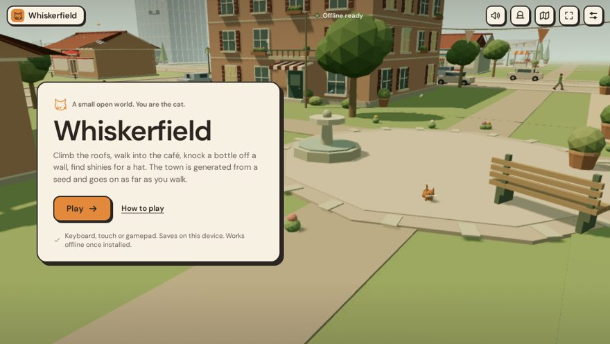
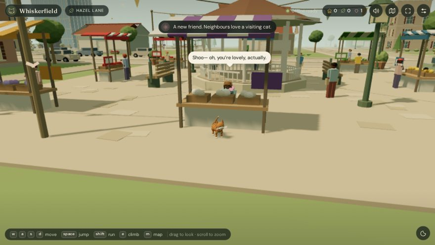
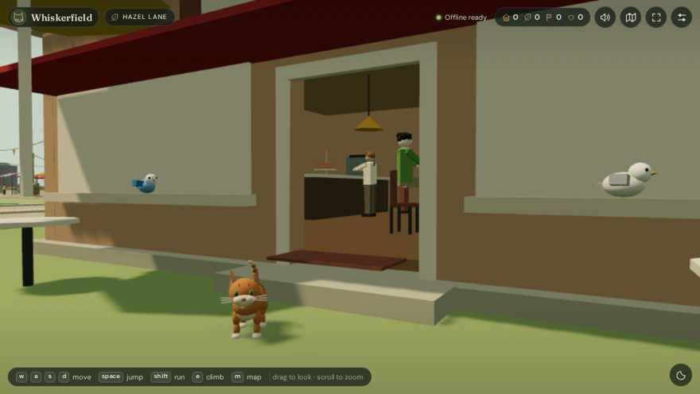

# Whiskerfield

A small open-world game where you are a cat. Climb roofs, walk into the café, knock bottles off walls, find shinies for a hat. The town is generated from a seed and keeps going as far as you walk.

Play it here: **https://cid0980.github.io/Whiskerfield/**

It is a static web app (three.js) that installs as a PWA and works offline after the first load. No account, no server, no analytics.







## What is in the town

- Endless streets of houses with varied footprints, roofs, balconies, awnings and chimneys, laid out in 72 m chunks from a seed.
- Districts with their own places: a market with stalls and a bandstand, a works with a flywheel and a smoking chimney, towers with outside stairs, a playground with a climbing frame and a trampoline, a warehouse yard, a railway station with a train you can climb on, allotments with a greenhouse to wander through, and a café, a shop and a house you can walk into.
- People who belong somewhere: stallholders, a baker, a mechanic, a waiter, a builder, children, grandparents. Workers stay at their post and look up when you come near; others stroll, chat, and stop to say hello.
- Birds on fences and ponds, crows on the chimneys, ducks with their ducklings on the park ponds, leaves, butterflies, and a small ambient soundtrack made with Web Audio.
- Shinies to collect (bottle caps, coins, marbles, keys…) on rooftops and ledges. Each one unlocks a bit more of the wardrobe: nine hats, from a leaf to a crown.
- Things to knock over: cones, bins, bottles, flowerpots, crates. People nearby will comment.
- Everything that is drawn is solid. You can climb most walls, trees and lamp posts; low steps and stairs you simply walk up.

Progress (position, discoveries, shinies, hat, settings) is saved in the browser. Add `?seed=some-words` to the address to open a specific town.

## Controls

| | Keyboard / mouse | Touch | Gamepad |
| --- | --- | --- | --- |
| Move | WASD / arrows | Left joystick | Left stick |
| Run | Hold Shift | Run button (toggles) | Triggers / L3 |
| Jump | Space | Jump button | A |
| Climb | Hold E at a wall, or keep walking into it | Hold climb button | B / RB |
| Look | Drag | Drag | Right stick |
| Zoom | Scroll | Pinch | |
| Map | M | Map button | |
| Hats | H | Hat button | |
| Nap | N | Moon button | |
| Settings | Esc | Settings button | |

Phones are asked for fullscreen landscape on Play; portrait still works.

## Running it locally

```bash
npm install
npm run build        # bundles src/ into assets/game.js, writes icons and sw.js
npm start            # serves on http://localhost:3000
npm test             # Playwright tests (first time: npx playwright install chromium)
```

Deploy by serving the folder over HTTPS (the service worker needs it). The repository deploys to GitHub Pages from `main`.

## How it is built

```text
index.html, styles.css   UI shell: title card, HUD, menus, touch controls
src/main.js              Game loop, camera, input, HUD, saves, PWA plumbing
src/world.js             Seeded chunk generator, geometry batching, colliders, map data
src/places.js            Landmark lots: market, works, towers, playground, warehouse, interiors
src/physics.js           Cat movement: steps, jumps, climbing, mantling, bouncy surfaces
src/npc.js               People: looks, roles, jobs, strolling and chatting
src/fun.js               Shinies, knock-over props, hats
src/birds.js             Birds that scatter when the cat gets close
src/cat.js               The cat model and its animation
src/audio.js             Web Audio ambience and sound effects
src/platform.js          Fullscreen, orientation and install helpers
scripts/build.mjs        esbuild bundle, icon rasterising, service-worker manifest
tests/game.spec.mjs      Playwright tests (gameplay, mobile layout, offline, saves)
```

Each chunk is one merged mesh with vertex colours; everything placed in it gets a collider automatically, and a few explicit ones (roof slopes, floors, steps) are added by hand. There are no textures or external assets apart from two font files.

## Changelog

- **1.4.0** – Further out: two new districts. A railway station (platform, canopy, kiosk, clock, and a steam engine with a carriage – all climbable, driver in the cab) and allotments (raised beds, bean poles, scarecrow, two sheds and a glass greenhouse you can walk into or sit on top of). A mother duck and her ducklings on every park pond; they paddle about, follow in a line, and scatter onto the bank if the cat gets too close. Crows – bigger, black, hoarse – perch on chimneys and rooftops. New quack and caw sounds, map icons and arrival lines for the new places, shinies on the carriage roof and the greenhouse.
- **1.3.3** – Fixes from play testing: gable roofs were rotated 90° on any non-square building (worst on the café/shop/home lots, where one slope hung past the wall); speech bubbles no longer show through roofs and walls; phone camera limits tightened (max zoom-out 9 m, pitch 55°, gentler pinch) so the cat cannot shrink to a dot.
- **1.3.2** – UI redesign: paper cards with ink outlines instead of dark glass, one sans-serif, plain copy. README rewritten.
- **1.3.1** – Shinies, knock-over props, hats (H).
- **1.3.0** – Districts and places: market, works, towers, playground, warehouse, enterable café/shop/home. People rewritten. Place discoveries on the HUD and map. Stairs and low steps are walked up from the leading paws.
- **1.2.5** – Global collision: every drawn primitive is solid.
- **1.2.4** – Catnap pose.
- **1.2.3** – Real ground heights for pavements, paths and roads.
- **1.2.2 / 1.2.1** – Fixes to climbing, saves and the map.
- **1.2** – Faster cat, sprint, higher jumps, shorter climb wind-up.
- **1.1** – Movement feel, cat animation, mobile controller, gamepad.

## Licences

MIT (see `LICENSE`). three.js is MIT; DM Sans is under the SIL Open Font License (`assets/fonts/`).
