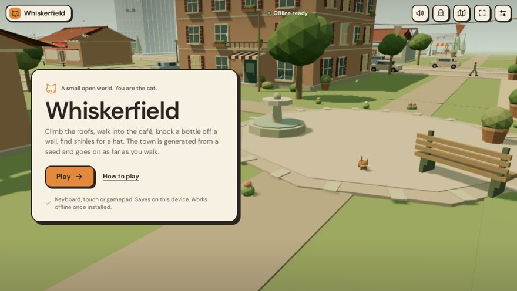
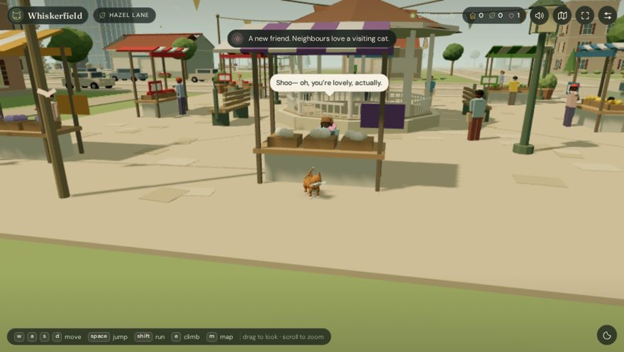
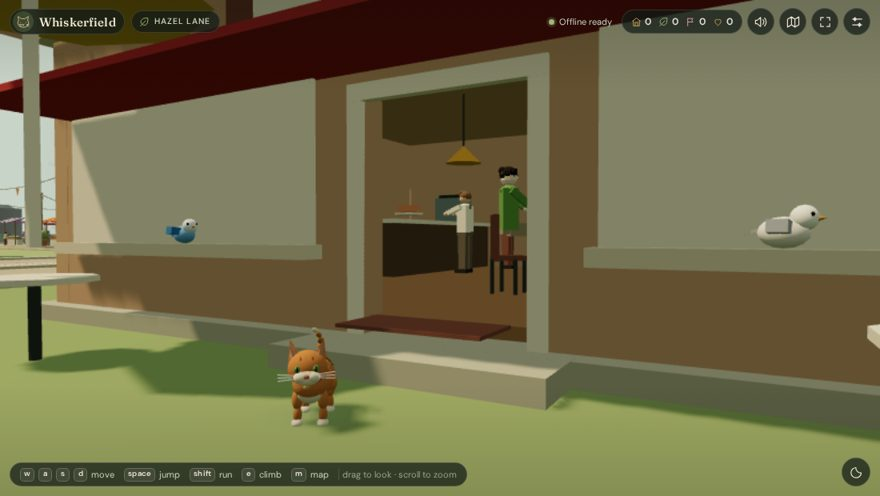

# Whiskerfield

A small open-world game where you are a cat. Climb roofs, walk into the café, knock bottles off walls, find shinies for a hat. The town is generated from a seed and keeps going as far as you walk.

Play it here: **https://cid0980.github.io/Whiskerfield/**

It is a static web app (three.js) that installs as a PWA and works offline after the first load. No account, no server, no analytics.







## What is in the town

- Endless streets of houses with varied footprints, roofs, balconies, awnings and chimneys, laid out in 72 m chunks from a seed.
- Every building has an inside. Houses have a front door that stands open and two furnished rooms behind it (sitting rooms, kitchens, bedrooms, studies, workshops, nurseries, painters’ studios, the odd piano). The works has a works floor with lathes and a press, towers have lobbies, the depot has racks of boxes, and the café, the grocer and the bakery are as they were.
- Districts with their own places: a market with stalls and a bandstand, a works with a smoking chimney, towers with outside stairs, a playground with a climbing frame and a trampoline, a warehouse yard, allotments with a greenhouse.
- Day and night. The sun comes up over the eastern roofs, crosses the sky and sets in the west; dusk brings a long orange horizon, then stars, a moon, lit windows and street lamps, and a cool dawn. A clock on the HUD shows the time; a setting pins it to day, sunset or night if you prefer.
- A railway. Lines run north–south every six chunks, with a station every other chunk, a footbridge, goods sidings and signal boxes between. A steam train calls at each station, waits, whistles and goes on. The carriages are hollow: step in through the doors, sit on the benches with the other passengers, or ride the roof.
- An airport two chunks east of the square (and every six chunks after that): terminal, control tower, apron, and a plane with its steps down. Walk up into the cabin, take the window seat, and the flight is a flight: the door shuts, you taxi, roll, climb over the town, cruise above the clouds, come down over the next country, land, and taxi to the stand where the door opens again. The whole thing takes a little over a minute, seen from your seat, the aisle and outside the plane; there is a Skip button if you are in a hurry.
- A lake, now and then: a whole block of water with a path round it, reeds, lily pads, ducks, a jetty and two rowing boats. Aboard a boat, point the stick toward open water and the boat goes that way and keeps going until you point it somewhere else, the bow meets the shore, or you step off. Point toward dry land and the cat simply walks ashore.
- The sea. Three blocks north of the square the town stops at a promenade and a beach; a stone harbour wall runs out to a lighthouse with boats moored alongside, and beyond that there is nothing but water (the railway crosses it on a viaduct).
- Balloon fields: a mown circle, a windsock, a ticket hut and a hot-air balloon on its tether. Climb the steps into the basket and wait a moment; it casts off, rises to thirty or forty metres and drifts wherever the wind is going, then comes down on whatever is underneath — a street, a roof, a field. Climb out and it finds its own way home.
- Four countries, one cat: Whiskerfield (home), Sunmarch (warm stone, red roofs, palms), Norrholm (snow, pines, red timber), Hanamura (blossom, dark tiles). Each has its own towns from the same seed. What you found in one waits for you if you fly back.
- People who belong somewhere: stallholders, a baker, a mechanic, a waiter, a builder, children, grandparents. Workers stay at their post and look up when you come near; others stroll, chat, and stop to say hello.
- Birds on fences and ponds, crows on the chimneys, ducks with their ducklings on the park ponds, leaves, butterflies, and a small ambient soundtrack made with Web Audio.
- Shinies to collect (bottle caps, coins, marbles, keys…) on rooftops and ledges. Each one unlocks a bit more of the wardrobe: nine hats, from a leaf to a crown.
- Things to knock over: cones, bins, bottles, flowerpots, crates. People nearby will comment.
- A minimap in the corner of the screen: the streets and buildings round you, the places you have found, and the cat in the middle pointing the way it is going. North is up; a tap opens the neighbourhood map.
- Everything that is drawn is solid. You can climb most walls, trees and lamp posts; low steps and stairs you simply walk up.

Progress (position, discoveries, shinies, hat, settings) is saved in the browser. Add `?seed=some-words` to the address to open a specific town.

## Controls

| | Keyboard / mouse | Touch | Gamepad |
| --- | --- | --- | --- |
| Move | WASD / arrows | Left joystick | Left stick |
| Run | Hold Shift | Run button (toggles) | Triggers / L3 |
| Jump | Space | Jump button | A |
| Climb | Hold E at a wall, or keep walking into it | Hold climb button | B / RB |
| Look | Drag | Drag | Right stick |
| Zoom | Scroll | Pinch | |
| Map | M | Map button | |
| Hats | H | Hat button | |
| Nap | N | Moon button | |
| Steer a boat | Move toward open water | Joystick toward open water | Left stick |
| Skip a flight | Skip button | Skip button | |
| Settings | Esc | Settings button | |

Phones are asked for fullscreen landscape on Play; portrait still works.

## Running it locally

```bash
npm install
npm run build        # bundles src/ into assets/game.js, writes icons and sw.js
npm start            # serves on http://localhost:3000
npm test             # Playwright tests (first time: npx playwright install chromium)
```

Deploy by serving the folder over HTTPS (the service worker needs it). The repository deploys to GitHub Pages from `main`. `scripts/push.sh "message"` builds nothing — build first — then commits everything and pushes.

Continuing the project? Start with [`HANDOFF.md`](HANDOFF.md): architecture, test API, release checklist, open bugs and the pitfalls learned so far.

## How it is built

```text
index.html, styles.css   UI shell: title card, HUD, menus, touch controls
src/main.js              Game loop, camera, input, HUD, saves, PWA plumbing
src/world.js             Seeded chunk generator, geometry batching, colliders, map data
src/places.js            Landmark lots: market, works, towers, playground, warehouse, interiors
src/physics.js           Cat movement: steps, jumps, climbing, mantling, bouncy surfaces
src/npc.js               People: looks, roles, jobs, strolling and chatting
src/fun.js               Shinies, knock-over props, hats
src/birds.js             Birds that scatter when the cat gets close
src/cat.js               The cat model and its animation
src/audio.js             Web Audio ambience and sound effects
src/platform.js          Fullscreen, orientation and install helpers
scripts/build.mjs        esbuild bundle, icon rasterising, service-worker manifest
tests/game.spec.mjs      Playwright tests (gameplay, mobile layout, offline, saves)
```

Each chunk is one merged mesh with vertex colours; everything placed in it gets a collider automatically, and a few explicit ones (roof slopes, floors, steps) are added by hand. There are no textures or external assets apart from two font files.

## Changelog

- **1.8.6** – The structure pass begins with roofs and shopfronts, the two things that were worst.
  Every pitched roof now has boarded eaves: a fascia lip along both edges with a half-round gutter
  hung under it, so a roof reads as built rather than as the edge of a sheet. And the café's awning —
  a flat red slab hanging over the pavement at a fixed height, which is what those odd red rectangles
  on the skyline were — is now what an awning is: a striped canvas sloping out over the terrace, a
  scalloped valance along its edge, a rail along the wall and two iron brackets holding it up.
- **1.8.5** – The railway has bends. Every line used to be a ruler: straight as a die from one edge of
  the world to the other, with the train running up and down it like a lift. Now the track eases out to
  one side between one station and the next and back again — a long swing a train leans into, then the
  other way at the next gap — and comes back to the straight exactly at each station, so the platform,
  the crossings, the footbridges and the signal boxes all still line up (the gap at the platform is
  nothing at all). The ballast, every sleeper and both rails are laid along the bend, and the train is
  three vehicles that each sit on their own bit of the line and turn to face along it, so a consist
  round a corner is a train and not three boxes cutting the corner. A cat aboard rides the bend too:
  the sideways shift is part of the ride.
- **1.8.4** – The water is finite now. The sea used to go on for ever: swim north past the harbour and
  the town would keep making open water for as long as you kept swimming, with nothing out there at
  all. It is a bay instead. A reef of black rock runs right across it a hundred and twenty metres out,
  with surf breaking on its seaward face, the water past it drawn darker and emptier, and a current
  that runs along it and turns a swimmer back ("Too rough out past the reef"). Lakes sit in a proper
  basin now as well: dry sand, then wet sand at the waterline, the shallows, the water, and two shades
  of depth out in the middle, with stones round the edge, instead of a flat disc laid on the grass.
- **1.8.3** – The works floor gets its foreman back. He was seated at his post inside the works office
  box — and that box is one solid block, so he spent every shift buried in it, where no cat could ever
  meet him. He now has a desk and a chair of his own beside the box, facing it, with the schedule
  pinned where he can see it.
- **1.8.2** – The view stops clipping. Two bugs were left in the camera after 1.8.0: while the
  over-the-shoulder sidestep eased in and out, the eye travelled between two directions that were each
  checked but through the wall between them, so walking along the front of a house could put you inside
  it for half a second; and the rule that lifts the eye over low clutter could lift it into a flowerpot
  or a market stall's beam, and the rule that keeps it off the ground could do the same. The eye now
  checks the direction it is actually looking from, and a last pass walks it back towards the cat until
  it is out of anything solid, whatever the easing did. A new test walks the cat about four corners of
  the town with the buttons mashed at random and insists that nothing goes wrong: no numbers lost to
  NaN, no falling out of the world, and never once an eye inside a wall. Also swept out some dead
  weight — a camera timer nothing had read since 1.8.0, an unused import and an unused helper.
- **1.8.1** – The cat is a cat, and it moves like one. Its body is now one tapered length along a curved
  spine — deep at the chest, tucked at the waist — with a neck that carries the head clear of the
  shoulders, almond eyes set into the skull, smaller ears, tapered legs with real thighs and paws, and a
  smooth tail carried up and curled. The tabby coat is painted into the fur: bands across the back, a pale
  belly, and no more stripes glued on as tubes. Legs keep pace with the ground: the gait is derived from
  the actual speed (a four-beat walk, a diagonal trot, a bounding gallop) instead of a fixed cadence, so
  the paws plant where they land, and the cat's top speed came down to 5 m/s walking and 8 sprinting,
  which is what a cat's legs can keep up with. Movement now follows where the *view* is pointed rather
  than where the camera has eased to, so flicking the mouse and pushing the stick together sends the cat
  the way you are looking. Lying down is a sphinx pose again, with the paws on the floor. And a boat no
  longer shakes: it used to roll by a fifth of a radian in whatever direction the heading error happened
  to point, which flipped sign every frame while you steered — it banks into a turn and eases back out,
  its deck is a run of round platforms so the cat rides the hull instead of an axis-aligned box that swung
  out from under it, and a cat aboard no longer bobs or slides.
- **1.8.0** – The towns, the trains, the planes, the water and the people all get their polish. Ten
  reports from the owner, fixed in pairs, each pushed on its own: the camera is one orbit rig that pulls
  in rather than through walls, knows when it is inside a room, and never shakes when the cat is cornered;
  the cat no longer scrambles over knee-high clutter, swims when it walks into the lake, and climbs onto
  roofs it could not reach before (an overhanging eave now gets hooked over instead of stopping the
  climb); furniture is kept clear of doorways and tower stairs are real stairs; the cat walks the length
  of a train carriage and sits in the aisle of a plane that no longer skims rooftops on the way out or
  comes down through a house on the way in; boats answer the stick, balloons drift with the wind and are
  boarded from a landing field; the minimap shows the town around the cat; people sit properly on their
  seats and turn to watch the cat go by. The whole suite (24 tests, one camera, movement, interiors and
  travel each) runs green.
- **1.7.10** – The flight path keeps to the flight path. 1.7.9 kept the blocks beyond each end of a runway clear of buildings, which took a whole block's worth of shops and houses out of the town either side of the airport. Only the two lots the runway actually points down are kept low now (allotments and a green patch), so the plane still comes down over empty ground and the town around it keeps its character.
- **1.7.9** – Rooftops you can actually reach. A cat climbing the outside of a house used to stop dead at the eaves: the roof edge overhangs the wall, so its head met the underside of the overhang a paw's width short of the top and it slid back down — on a single-storey house with a low roof, that meant the roof was unreachable. A climbing cat now hooks over a thin eave or ledge within reach and pulls itself up onto it (the same move it makes at the top of any wall), and a facade that carries on above the ground-floor wall — an upper storey standing on it — is climbed as one face instead of being abandoned at the ledge between the two.
- **1.7.8** – People sit down properly. Anyone sitting — the café customers, the office floor, the regulars in the grocer — used to hover a third of a metre above their chair, because the seated pose lowered the body by a fixed amount instead of to the seat. The seat is now measured (whatever is actually under them: a café chair, an office chair, a bench), and the hips come down to it, so a seated person is sitting on the chair. They also turn their head and shoulders round to watch the cat go by instead of staring at their job, and say hello when you come within a step. Knee-length skirts became mid-thigh, so sitting no longer puts their legs through the cloth.
- **1.7.7** – Flying clear, and a cabin you can walk about in. An airliner used to leave the ground with the rooftops still coming: the climb was a slow quadratic, so the first block or two after the runway were crossed at ten metres over houses nine metres tall. It now climbs away steeply, and the two blocks either side of every runway are kept clear of buildings altogether — park and allotments instead of houses — so nothing stands in the approach or departure lane. Inside the cabin, the seats were blocking their own aisle: one collision box per *pair* of seats reached into the middle and left half a metre to squeeze through, which is why moving about in the plane felt stuck. Each cushion has its own collider now, the aisle is .64 m clear from the galley to the cockpit door, and a cat can step up onto a seat rather than bumping it. A full flight is checked frame by frame in the tests: no building within three metres of the plane, from the stand to the stand.
- **1.7.6** – Doors you can walk through, and stairs that are stairs. Furniture no longer ends up in doorways: every room is now furnished with its doorway reserved — the apron inside the front door, the opening through the partition, and anything a kit tries to put there is dropped from the mesh *and* the collision set — and the partition itself slides clear of the front door instead of ending in it. The open door leaf used to stand a metre inside the room and block half the opening; it is now swung flat against the wall beside the door. Doors also remember where they are (`building.door`), so the rule applies to every house, café, grocer, living room and wing in town, and a test walks every one of them. And the tower stairs are proper stairs: flat treads with risers under 21 cm (about fifteen per floor) instead of a tilted ramp, a landing at each foot, a stairwell opening wide enough that a climbing cat's head is under it rather than under the floor above, and no invisible ramp of a collision box across the flight — the cat now walks from the lobby to the first floor without scrambling.
- **1.7.5** – In the water, and on the train. A cat that ended up in the lake or the sea used to trudge along the bottom, half submerged, because the bank is higher than a step from the lake bed and there was no way out except walking the whole shore; the cat swims now — it floats at the waterline with its head up, paddles about a third slower than it trots, and the bank is a step again the moment it reaches it, so any stretch of water is a place you can fall into and climb out of (and after twenty seconds of treading water with no way out it drifts toward the nearest shore on its own). Boarding a train is a walk, not a scramble: the station platform now reaches the carriage, the running board is flush with the floor instead of a six-centimetre ledge below it, the doors are half a metre wider (1.8 m) so you no longer have to line up exactly, the carriage floor is wider, and the benches are pushed back against the walls to leave a metre of aisle you can run down from one end to the other.
- **1.7.4** – Smoother towns, steadier camera. Walking into a new block used to stall the game for up to a fifth of a second while it was built in one go; now the work is spread over a few frames (a town block is generated in stages, never in one lump), and the vertex building behind every chunk is about twice as fast — typed arrays written by index instead of growing lists, cached colour parsing, and a short path for upright boxes and cylinders, which is most of a town. The camera no longer shakes in small rooms: when the cat is pressed into a corner the rig picks a roomier angle and *keeps* it while it still has room, easing the offset in and out, instead of re-deciding every frame; and the eye pulls in fast when something comes between it and the cat but relaxes back out slowly, so it no longer breathes in and out at doorways.
- **1.7.3** – The little map, and rooms that are taller than a house's. A square minimap now sits in the top right corner: the streets, buildings, parks and places around the cat, the cat itself in the middle with an arrow for the way it is facing, a soft wedge for where you are looking, north up, and a tap opens the full map. Boats answer the stick straight away — twice the acceleration and twice the turn rate, and a bit more top speed. And the rig used to call a place "indoors" only when The rig used to call a place "indoors" only when the ceiling was under 3.05 m, so the café, the grocer and somebody's living room — ceilings at 3.55 m — were treated as open air and the camera drifted out through the doorway to eight metres away, leaving you looking down at the roof from outside. Indoors is now simply *is there a roof over the cat* (any height up to a couple of storeys), and the eye is kept below it at both ends of the shot, so a room with a tall ceiling behaves like a room. A pitched roof with no separate ceiling under it (an annexe, a shopfront) counts as that room's ceiling too. The "see over the roof" lift outdoors is now capped at 2.4 m instead of climbing six metres for a better view.
- **1.7.2** – The camera, indoors and out. One orbit rig replaces the per-room special cases: a swept-sphere test against every nearby shape (walls, floors above, carriages, cabins, roofs as slopes, moving boats and balloons) pulls the eye in until nothing is between it and the cat, so inside a house, a train carriage or a tower the cat is always in view instead of hidden behind a wall. Indoors the rig shortens to suit the ceiling, dips under it, and looks for the nearest direction that actually has room when the cat is pressed into a corner — over the shoulder, or over the cat's own head — rather than filling the screen with fur. Outdoors it relaxes back out slowly. Looking up is a real thing now: the pitch limit is −1.32 rad (was −0.62), and when the ground lifts the eye the look-at point rises with it, so the sky, the airliners and the balloons are there to see. Riding a boat, train, lift or balloon follows the whole of the support's movement before smoothing, so the view no longer lags or sticks on a ride. Drag, touch and gamepad share one sensitivity curve. Also: the cat no longer scrambles up knee-high clutter (auto-scramble needs a wall at least a cat tall, with somewhere to land at the top), and the collider solver pushes out in smaller steps, so brushing past overlapping props no longer sets the cat bouncing about. The aeroplane's shell is now two half-tubes opening into the cabin, so the fuselage's own skin is no longer drawn across the inside of the cabin.
- **1.7.1** – Settings show the real version and build time, and a **Check for updates** button asks the service worker for a newer build (comparing `version.json` straight from the server) and reloads when one is ready. `HANDOFF.md` added: a working guide for whoever continues the project.
- **1.7.0** – Time, water and ways to travel. A full day–night cycle with sunset, dusk, stars, moon, lit windows and lamps, and dawn, plus a HUD clock and a time setting. Train carriages are hollow and enterable, with benches and passengers. Flights are no longer a cut: the cat sits in a window seat among other passengers while the plane taxis, takes off, climbs, cruises above clouds, descends, lands and taxis in; cameras move between seat, window, aisle and outside views; the world changes country under the clouds; a Skip button is available. New lake blocks with jetties, reeds, lily pads and rowing boats that go where you point them; a seafront three blocks north with promenade, beach, harbour wall, lighthouse and boats, and open sea beyond (the railway continues on a viaduct; no airports or stations at sea). Balloon fields with real balloon rides on the wind that land wherever they come down. Townsfolk keep to dry land.
- **1.6.0** – Taller, wider, better dressed. Towers are real multi-storey buildings: a lobby, a floor every three metres (offices, gyms, cafés, flats), scissor stairs along the back wall and a glass lift in the corner that takes the cat up when it steps aboard and comes when called. Many houses grow an L-shaped wing with its own pitched roof and a room inside. A wardrobe (H) replaces the hat list: hats, neckwear and backpacks can all be worn at once, previewed on a live 3D cat you can spin. Collected shinies show their true per-kind counts. The cat moves like a cat: blended walk/trot/gallop gaits, sways, stretches and sits when idle. The camera can look straight up and down. Fixed: the cat can no longer climb through a ceiling onto the roof from inside a house; mantling onto a gable roof no longer leaves the cat inside the roof with the camera snapping about.
- **1.5.0** – Indoors and abroad. Every house, the works, the towers and the depot now have interiors you can walk into, with furniture that is solid and people who live there. A railway with a running steam train (ride on the roof), footbridges, sidings and signal boxes. An airport with a terminal, a control tower and a plane: board it and fly to one of three other countries, each with its own palette, trees, weather and street names; fly home again from there. Airliners cross the sky; two hot-air balloons drift over the town. New sounds: whistle, chuff, jets. Snow-capped pines, palms and a snowman where the climate calls for them. Fixed: tile strips on gable roofs no longer leave invisible walls on the roof.
- **1.4.0** – Further out: two new districts. A railway station (platform, canopy, kiosk, clock, and a steam engine with a carriage – all climbable, driver in the cab) and allotments (raised beds, bean poles, scarecrow, two sheds and a glass greenhouse you can walk into or sit on top of). A mother duck and her ducklings on every park pond; they paddle about, follow in a line, and scatter onto the bank if the cat gets too close. Crows – bigger, black, hoarse – perch on chimneys and rooftops. New quack and caw sounds, map icons and arrival lines for the new places, shinies on the carriage roof and the greenhouse.
- **1.3.3** – Fixes from play testing: gable roofs were rotated 90° on any non-square building (worst on the café/shop/home lots, where one slope hung past the wall); speech bubbles no longer show through roofs and walls; phone camera limits tightened (max zoom-out 9 m, pitch 55°, gentler pinch) so the cat cannot shrink to a dot.
- **1.3.2** – UI redesign: paper cards with ink outlines instead of dark glass, one sans-serif, plain copy. README rewritten.
- **1.3.1** – Shinies, knock-over props, hats (H).
- **1.3.0** – Districts and places: market, works, towers, playground, warehouse, enterable café/shop/home. People rewritten. Place discoveries on the HUD and map. Stairs and low steps are walked up from the leading paws.
- **1.2.5** – Global collision: every drawn primitive is solid.
- **1.2.4** – Catnap pose.
- **1.2.3** – Real ground heights for pavements, paths and roads.
- **1.2.2 / 1.2.1** – Fixes to climbing, saves and the map.
- **1.2** – Faster cat, sprint, higher jumps, shorter climb wind-up.
- **1.1** – Movement feel, cat animation, mobile controller, gamepad.

## Licences

MIT (see `LICENSE`). three.js is MIT; DM Sans is under the SIL Open Font License (`assets/fonts/`).
